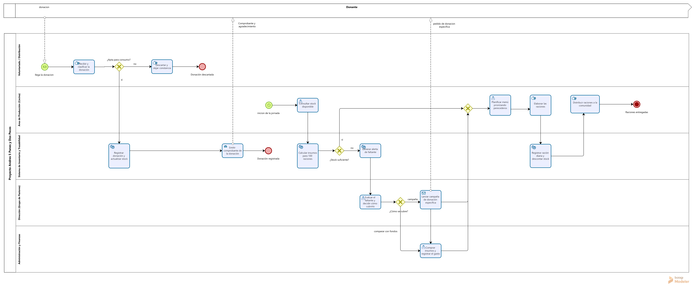

# Proceso de negocio (BPMN 2.0)

**Proceso:** gestión de donaciones y elaboración diaria de raciones.

- `proceso-donaciones-raciones.bpm`: archivo editable de **Bizagi Modeler** (se abre con *Archivo → Abrir*). El diagrama pasó la validación de Bizagi.
- `proceso-donaciones-raciones.png`: imagen exportada desde Bizagi.

## Participantes

| Elemento BPMN | Quién es | De dónde sale |
|---|---|---|
| Pool externo | **Donante** (persona, iglesia o comercio) | Ambiente / vinculación próxima (Entrega 1) |
| Pool interno | **Proyecto Andrés 5 panes y dos peces** | Organización elegida (Entrega 1) |
| Carril | Voluntariado / Distribución | Organigrama, nivel operativo (Entrega 3) |
| Carril | Área de Producción (Cocina) | Organigrama, nivel medio |
| Carril | **Sistema de Inventario y Trazabilidad** | Módulo de software propuesto (Entrega 1) |
| Carril | Dirección (Grupo de Pastores) | Organigrama, nivel superior |
| Carril | Administración y Finanzas | Organigrama, nivel medio |

## Recorrido

**A. Ingreso de una donación.** El evento de inicio es un mensaje.

1. El voluntariado recibe y clasifica la donación (tarea manual).
2. Un gateway exclusivo pregunta: **¿apta para consumo?** Si no lo es, se descarta y queda constancia. Si lo es, el **sistema registra la donación y actualiza el stock** (tarea de servicio), con la entidad `Donacion`.
3. El sistema emite un comprobante, que se envía al donante (flujo de mensaje).

**B. Elaboración diaria de 100 raciones.** El evento de inicio es un temporizador diario.

1. Cocina consulta el stock y el sistema calcula los insumos para 100 raciones.
2. Gateway: **¿stock suficiente?**
   - **Sí:** se pasa directo a planificar el menú.
   - **No:** el sistema genera una **alerta de faltante**. Dirección evalúa y decide en el gateway **¿cómo se cubre?**: una *campaña de donación* (mensaje al donante) o una *compra con fondos*, que hace Administración y Finanzas.
3. Un gateway de unión junta los caminos. Cocina planifica el menú priorizando los perecederos y elabora las raciones.
4. El **sistema registra la ración diaria** (`Racion_Diaria`), descuenta el stock y marca `Hubo_Faltantes`.
5. El voluntariado distribuye las raciones. Fin: raciones entregadas.

## Tipos de tarea

- **Manual** (ícono de mano): trabajo físico sin sistema. Ejemplos: recibir, cocinar, distribuir.
- **De usuario** (ícono de persona): una persona usa el sistema. Ejemplos: consultar stock, decidir, registrar una compra.
- **De servicio** (ícono de engranaje): el sistema lo hace solo. Ejemplos: actualizar stock, calcular, alertar.
- **De envío** (sobre negro): el sistema o una persona envía un mensaje a otro participante.
